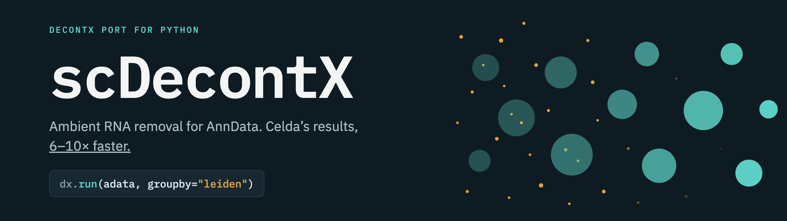
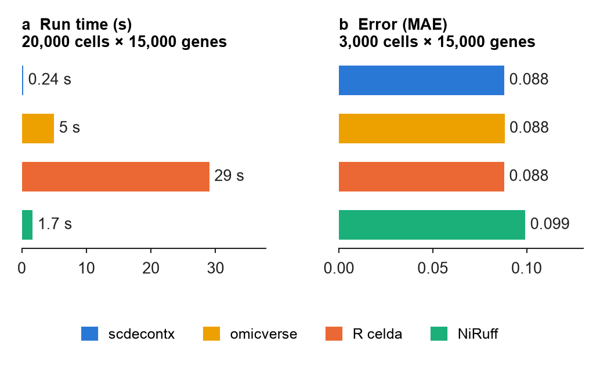
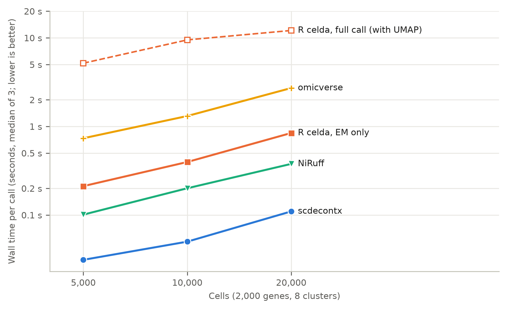

# scDecontX

Ambient RNA removal for scverse. scDecontX is celda's DecontX for `AnnData`: the same results as R, 6–10× faster, with one function.

```python
import scdecontx as dx

dx.run(adata, "leiden")
```

- **The same results as R.** scDecontX implements celda's `decontX` with its defaults, prior fit and outputs. From the same initial values the contamination estimates agree with R to within 6e-15 and the corrected counts to within 7e-13 (pbmc3k; 4e-14 on simulated data).
- **Fast.** Parallel Numba kernels process the nonzero counts, with separate updates to the cluster gene profiles. On 20,000 cells × 15,000 genes a call takes 0.24 s, against 2.3 s for celda's EM and 29 s for a full R `decontX()` call.
- **scverse-native.** Raw counts from `.X` or a layer, clusters from `obs`, batches, empty droplets as background; results in `obs["scdecontx_contamination"]`, `layers["scdecontx_counts"]` and `uns["scdecontx"]`.

## Install

Install it with:

```bash
pip install git+https://github.com/mhbsiam/scdecontx.git
```

or from a clone:

```bash
pip install .
```

**Dependencies.** Python ≥ 3.11 with `numpy`, `scipy`, `pandas`, `numba` and `anndata`. pip pulls them in. scanpy is not required, but the usual workflow clusters with it first.

**Conda.** `environment.yml` creates an environment with scDecontX, the latest scanpy, leiden clustering and JupyterLab:

```bash
conda env create -f environment.yml
conda activate scdecontx
```

## Usage

`adata` holds raw counts in `.X` (or in `layers[layer]`) and cluster labels in `obs`:

```python
dx.run(adata, "leiden")                          # celda's decontX, tol 1e-3
dx.run(adata, "leiden", batch_key="sample")      # one fit for each sample
dx.run(adata, "leiden", background=empty)        # empty droplets fix the ambient profile

adata.obs["scdecontx_contamination"]               # contamination fraction of each cell
adata.layers["scdecontx_counts"]                   # decontaminated counts
adata.uns["scdecontx"]                             # parameters and convergence
```

### Parameters of `dx.run`

| Parameter | Default | Meaning |
|---|---|---|
| `adata` | required | `AnnData`, cells × genes, with raw counts in `.X` or in `layers[layer]` |
| `groupby` | required | column of `obs` with the cluster of each cell |
| `batch_key` | `None` | column of `obs` with batches; each batch is fitted separately |
| `layer` | `None` | layer holding the raw counts instead of `.X` |
| `background` | `None` | `AnnData` of raw empty droplets; their pooled profile replaces the estimated contamination profile, as in R's `decontX(background=)`. Genes are matched by `var_names`; droplets whose barcode is a cell are removed |
| `background_batch_key` | `None` | column of `background.obs` with the batch of each droplet; required with `batch_key` and `background` |
| `delta` | `(10.0, 10.0)` | Beta prior of the native proportion, and the start of its fit |
| `estimate_delta` | `True` | fit `delta` in each iteration |
| `max_iter` | `500` | maximum EM iterations (celda's `maxIter`) |
| `tol` | `1e-3` | stop when no native proportion changes by more than this in one iteration (celda's `convergence`) |
| `random_state` | `0` | seed of the initial native proportions; each batch gets its own seed |
| `dtype` | `"float64"` | `"float32"` halves the memory of the counts and the output layer |
| `key_added` | `"scdecontx"` | prefix of the output keys |
| `copy` | `False` | return a copy instead of writing to `adata` |

Returns a copy of `adata` if `copy=True`, otherwise `None`. Writes `obs["scdecontx_contamination"]` (NaN for cells without counts), `layers["scdecontx_counts"]` (fractional, same sparsity as the input) and `uns["scdecontx"]` (parameters, fitted `delta`, convergence of each batch).

See the [tutorial notebook](tutorial/scdecontx_tutorial.ipynb) for the parameters in use, and the documentation for the [workflow](docs/workflow.md), the [API](docs/api.md) and the [method](docs/methods.md).

## Comparison



Run time of one call on 20,000 cells × 15,000 genes (median of 3 warm calls; R celda is the full `decontX()` call, UMAP included), and the mean contamination error on 15 simulated datasets of 3,000 cells × 15,000 genes with 9–50% contamination; lower is better in both.



Wall time of one call by number of cells (median of 3 warm calls), each implementation at its defaults. Solid R line: celda's EM only; dashed: the full `decontX()` call, which includes a UMAP.

**Data.** Accuracy datasets are simulated with `celda::simulateContamination`, so the true contamination of every cell is known: 15 datasets of 3,000 cells × 15,000 genes and 15 of 2,000 cells × 1,000 genes, each at five contamination levels from 9% to 50% with three seeds, plus 4 datasets where 16 cell types are given to the methods as 8 clusters. Run time is measured on simulated sets of 5,000–20,000 cells, and on PBMC3k (10x Genomics, 2,700 cells). The comparison covers R [celda](https://github.com/campbio/celda) 1.24.0, [NiRuff/decontx-python](https://github.com/NiRuff/decontx-python) and [omicverse/py-decontx](https://github.com/omicverse/py-decontx), each at its defaults. MAE is the mean absolute error of per-cell contamination; lower is better.

|  | scDecontX | R celda | NiRuff | omicverse |
|---|---|---|---|---|
| Contamination MAE, 15,000 genes | 0.088 | 0.088 | 0.099 | 0.088 |
| Contamination MAE, 1,000 genes | 0.037 | 0.037 | 0.041 | 0.037 |
| Contamination MAE, merged clusters | 0.085 | 0.085 | 0.097 | 0.085 |
| Run time, PBMC3k (2,700 cells) | **0.33 s** | 6.3 s (2.1 s EM) | 1.3 s | 5.3 s |
| Run time with the same stop rule | **1×** | 6.3–9.6× slower (EM only) | 3.2–7.1× slower | 16–26× slower |
| Input nonzeros kept | 100% | 100% | 56–98% | 100% |
| Max contamination difference from R, same start | **6e-15** | – | 0.006–0.061 | 9e-15 |

**How the ports differ**

- **scDecontX**: follows celda step by step, with the same defaults, prior fit and outputs. Results do not depend on the number of threads.
- **omicverse/py-decontx**: same estimates as R, but loops over cells in Python (16–26× slower). Matches empty droplets to genes by position, and uses the same droplets for every batch.
- **NiRuff/decontx-python**: changes the estimator, so it differs from R (by up to 0.061). Rounds the corrected counts, dropping 2–44% of the nonzeros.

**scDecontX on the DecontX paper's real datasets**

- **Human–mouse mixture**: with species labels as clusters and no background, estimates closely match each cell's other-species UMI fraction (r = 1.000; RMSE 0.0002–0.0013). This measures cross-species contamination, not total contamination. The paper reports 0.002–0.006 on a different cell selection (12,079 cells against 12,165 here).
- **CellBench RNA mixtures**: estimates correlate with the designed mixing proportions (Pearson r = 0.71 for CEL-seq2 and 0.86 for SORT-seq). Median estimates differ from the published values; the design does not measure contamination added during library preparation.
- **pbmc4k**: the share of cells with other cell types' markers differs from flow-sorted references by 0.42 on average (over pairs of types) before correction and by 0.038–0.046 after.
- **With empty droplets as `background`**: total contamination agrees with an estimate derived from the cross-species fraction and the composition of the same empty droplets (MAE 0.003). This checks consistency with the background, not an independent measurement.

Full benchmark, with design, statistics and how to reproduce it: [`tests/benchmarks/README.md`](tests/benchmarks/README.md).

## Acknowledgments

scDecontX is a Python/Numba reimplementation of celda's DecontX (Yang et al. 2020)

DecontX is by Yang et al. (2020), *Genome Biology* 21:57; its reference implementation is in the R package [celda](https://github.com/campbio/celda). The CSR-aligned EM design follows Jason Jia's [jjia1/decontx-python](https://github.com/jjia1/decontx-python), and Nicolas Ruffini's [decontx-python](https://github.com/NiRuff/decontx-python) showed how DecontX fits into an AnnData workflow. MIT license.

## Citation

If you use scDecontX, cite it together with the DecontX paper:

> Yang, S., Corbett, S. E., Koga, Y., Wang, Z., Johnson, W. E., Yajima, M., & Campbell, J. D. (2020). Decontamination of ambient RNA in single-cell RNA-seq with DecontX. *Genome Biology*, 21, 57. https://doi.org/10.1186/s13059-020-1950-6

> Siam, M. H. B. (2026). *scDecontX* (Version 1.0.0) [Computer software]. GitHub. https://github.com/mhbsiam/scdecontx
