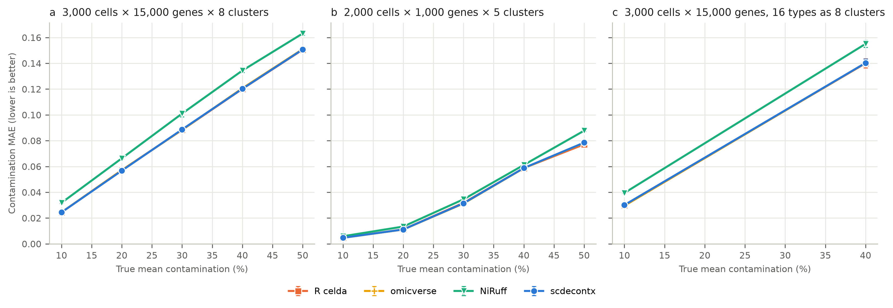

# Benchmark of DecontX implementations

This benchmark compares scDecontX with the reference R implementation of DecontX (celda) and two other Python implementations. It measures agreement with R, speed, accuracy on simulated ground truth, and accuracy on the real datasets of the DecontX paper. The scripts in `scripts/` generate everything from fixed seeds.

## Summary

scDecontX runs celda's algorithm. From the same initial values it reproduced celda to 6 × 10⁻¹⁵ in contamination and 7 × 10⁻¹³ in counts, with the same number of iterations, and matched R's accuracy on simulated data (MAE 0.088 at 15,000 genes). It was the fastest implementation: 6.3–9.6× faster than celda's EM and 120× faster than a full R `decontX()` call at 20,000 cells × 15,000 genes (0.24 s against 2.3 s and 29 s). On the real datasets of the DecontX paper it reproduced the paper's results: in the 10x human–mouse mixture its contamination matched each cell's fraction of other-species reads (RMSE 0.0002 in human and 0.0013 in mouse cells, against 0.002 and 0.006 in the paper), and in the CellBench RNA mixtures it followed the mixing design. A leave-one-out variant was 3.7× more accurate on simulated data but not on these real data, so scDecontX keeps celda's estimator (Section 3.10).

## 1. Implementations

| Implementation | Version | Language / engine | Estimator | Default stop rule |
|---|---|---|---|---|
| scDecontX | 1.0.0 (this repository) | Python, Numba | celda's estimator | max \|Δθ\| < 1e-3, ≤ 500 iterations |
| R celda `decontX` | 1.24.0 (Bioconductor 3.21) | R, C++ (single thread) | in-sample cluster profile | max \|Δθ\| < 1e-3, ≤ 500 |
| NiRuff/decontx-python | 0.2.0, commit `cd86f0b` | Python, Numba | posterior mode, clamped moment-matched prior | 1e-3, checked every 10th iteration, ≤ 500 |
| omicverse/py-decontx | 0.1.0, commit `4c97b32` | Python, NumPy | celda's estimator | 1e-3, ≤ 500 |

Exact commits are in `environment/implementations.tsv`; `scripts/setup_others.sh` clones them. The scDecontX runs in `results/results.json` used the R-compatible mode of commit `d033daf`, which computes the same algorithm as this release (the current code reproduces the celda fixtures in `tests/test_celda.py` to 1e-10 and that mode to 1e-14).

## 2. Design

### 2.1 Simulated data

Simulated data come from `celda::simulateContamination` with its defaults (`NRange = c(500, 1000)`, `beta = 0.1`, `numMarkers = 3`). Each cell's contamination fraction is drawn from Beta(δ₁, δ₂): δ = (1, 10), (2, 8), (3, 7), (4, 6) and (5, 5) give mean contamination of about 9–50%. The simulator returns the native counts and the true contamination of every cell.

| Group | Cells | Genes | Clusters | Contamination | Seeds | Datasets | Purpose |
|---|---|---|---|---|---|---|---|
| sweep, 15,000 genes | 3,000 | 15,000 | 8 | 9–50% | 21, 22, 23 | 15 | realistic gene count |
| sweep, 1,000 genes | 2,000 | 1,000 | 5 | 9–50% | 11, 12, 13 | 15 | celda's small-scale setting |
| merged clusters | 3,000 | 15,000 | 16 types, given as 8 | 9%, 40% | 41, 42 | 4 | heterogeneous clusters |
| accuracy | 2,000 | 1,000 | 5 | 9%, 40% | 1–3, 1–2 | 5 | R agreement |
| speed | 5,000–20,000 | 2,000 | 8 | 9% | 7 | 3 | scaling with cells |
| speed, 15,000 genes | 20,000 | 15,000 | 8 | 9% | 7 | 1 | realistic size |

*Merged clusters* simulate 16 cell types and give the methods 8 clusters, each the union of two types, as coarse clustering of real data does. `tests/_soup.py` adds a second simulator in which all droplets share one ambient pool (Section 3.7).

### 2.2 Real data

| Dataset | Source | Cells | Truth | Section |
|---|---|---|---|---|
| PBMC3k | 10x Genomics (copy in the omicverse repository) | 2,700 | none | 3.5 |
| hgmm_12k, human HEK293T and mouse NIH3T3 cells | 10x Genomics, raw matrix with empty droplets | 12,165 after removing multiplets | other-species reads in each cell | 3.8 |
| CellBench RNA mixtures, CEL-seq2 and SORT-seq | Tian et al. 2019, `LuyiTian/sc_mixology` | 258 and 222 pseudo-cells | mixing design: 0 or 32% other cell lines | 3.9 |
| CellBench single cells, 3 or 5 lung adenocarcinoma lines; 10x, CEL-seq2, Drop-seq | same | 225–3,918 per dataset | demuxlet doublets | 3.9 |
| pbmc4k and 8 flow-sorted PBMC populations | 10x Genomics (Zheng et al. 2017) | 4,336 | marker expression of populations sorted into separate channels | 3.9 |

PBMC3k is filtered (`filter_cells(min_genes=200)`, `filter_genes(min_cells=3)`; 13,714 genes) and Leiden-clustered in scanpy (total-count normalization, log1p, 2,000 HVGs, 30 PCs, resolution 0.5, `random_state=0`): 8 clusters of 12–1,117 cells. Download commands for the other datasets are in the scripts; files go to the git-ignored `data/` folder.

### 2.3 Settings

Every implementation receives the same counts and cluster labels, `delta = (10, 10)`, `estimate_delta = TRUE` and seed 12345, and runs at its default stop rule (Section 1). celda always computes a UMAP before the EM; it is timed separately. For the agreement analysis, Python implementations also ran from R's own initial θ, captured inside celda with `trace()` (*same start*), which removes R–NumPy RNG differences.

### 2.4 Metrics

For cell *j* with true contamination *c*ⱼ and estimate *ĉ*ⱼ:

- **MAE** = mean over cells of |*ĉ*ⱼ − *c*ⱼ|; **bias** = mean of *ĉ*ⱼ − *c*ⱼ.
- **Counts relative error** = ‖*N̂* − *N*‖_F / ‖*N*‖_F, with *N* the true native count matrix and *N̂* the decontaminated counts.
- **Agreement with R** = max over cells of |*ĉ*ⱼ − *ĉ*ⱼ^R| (and the same over all count entries).
- **Consistency** = max over cells of |*ĉ*ⱼ − (1 − Σ*N̂*ⱼ / Σ*X*ⱼ)|: zero when the reported contamination is the fraction removed from the returned counts.
- **Nonzeros kept** = fraction of input nonzeros that are nonzero in the output.

### 2.5 Timing

Each Python run was a fresh process: import, one cold call (including Numba compilation), then 3 timed warm calls; tables report median and range. R ran 3 calls in one session; *R EM* subtracts the UMAP time measured by `trace()`. scDecontX and NiRuff used all 11 cores; R is single-threaded, so scDecontX was also timed with `NUMBA_NUM_THREADS=1`. Machine and software are in `environment/`.

## 3. Results

Detailed tables: [`results/tables.md`](results/tables.md). Per-run metrics: [`results/metrics.csv`](results/metrics.csv).

### 3.1 Accuracy against run time


**Figure 1. Run time and accuracy.** Each implementation at its defaults. (a) Wall time of one call on 20,000 cells × 15,000 genes (12.2 million nonzeros; median of 3 warm calls). For R celda this is the full `decontX()` call, including the UMAP it always computes; its EM alone takes 2.3 s (Table 3). (b) Mean contamination MAE over the 15 datasets with 15,000 genes (Figure 2a). scDecontX, R celda and omicverse share the same MAE because they compute the same estimator.

### 3.2 Accuracy on simulated data



**Figure 2. Accuracy.** Contamination MAE by true contamination level (mean ± SD over 3 seeds; merged clusters: 2 seeds). (a) 15,000 genes; (b) 1,000 genes; (c) merged clusters. scDecontX, R celda and omicverse overlap because they compute the same estimator (Table 2).

At 15,000 genes scDecontX, R celda and omicverse had MAE 0.088 ± 0.046 and NiRuff 0.099 (Table 1). All four underestimated contamination — about 0.024 at 10% and 0.15 at 50% — because each cell is scored against a cluster profile that includes itself, so part of its contamination looks native; the bias grows with the number of genes. At 1,000 genes the error was 0.037 (NiRuff 0.041) and with merged clusters 0.085 (NiRuff 0.097).

### 3.3 Agreement with R

From the same start, scDecontX agreed with celda to ≤ 5.8 × 10⁻¹⁵ in contamination and ≤ 7.2 × 10⁻¹³ in counts, with identical iteration counts. omicverse agreed to ≤ 8.8 × 10⁻¹⁵ and NiRuff differed by 0.006–0.061 (Table 4). With their own seeds, every implementation differs from R by the run-to-run variation of R itself, about 10⁻³ to 10⁻².

### 3.4 Speed


**Figure 3. Speed.** Wall time of one call by number of cells (median of 3 warm calls), each tool at its default settings. Solid R line: celda's EM only; dashed: the full `decontX()` call, which includes a UMAP. Single-thread timings are in Table 3.

scDecontX was the fastest implementation: 0.11 s for 20,000 cells × 2,000 genes, against 0.84 s for celda's EM (12.1 s with its UMAP), 0.38 s for NiRuff and 2.7 s for omicverse. At 20,000 cells × 15,000 genes it took 0.24 s, against 2.3 s for celda's EM, 29 s for the full call, 1.7 s for NiRuff and 5.0 s for omicverse. Single-threaded it was still 3.0–3.2× faster than celda's EM. scDecontX needed the same number of iterations as R (12–17).

### 3.5 PBMC3k

PBMC3k has no ground truth. scDecontX estimated 8.7% mean contamination, R celda and omicverse 8.9%, and NiRuff 6.8% (Table 5); the per-cluster means of scDecontX and R differed by at most 0.5 percentage points, as two R seeds do.

### 3.6 Output integrity

scDecontX, R and omicverse report the contamination of the E-step before the final update and differ from their returned counts by up to 10⁻³, the stop tolerance. NiRuff reports 1 − θ, which differs from its counts by up to 0.13, and rounds the counts to integers, removing 2–44% of the input nonzeros (Table 6).

### 3.7 Soup scenarios

`simulateContamination`, and so Sections 3.1–3.6, draws each cell's contamination from the other clusters only: the DecontX model itself. `scripts/scenarios.py` instead uses the simulator in `tests/_soup.py`, where all droplets share one ambient pool (soup). Each scenario breaks one assumption: S1 the soup includes the cell's own type, S2 one type releases 10× more RNA, S3 some genes are enriched in the soup, S4 each cluster holds two types, S5 cells have 200–500 UMI; S6 combines them, S0 keeps the model, and S7 mimics the human–mouse mixture (two large clusters, soup mildly unlike the cells; Section 3.8). Each runs at about 3%, 9% and 40% contamination, with and without the empty droplets as background, and is scored against the *oracle*, the posterior under the true parameters — the floor left by sampling noise. Tables: [`results/scenarios.md`](results/scenarios.md).

Without background, soup of the cell's own type looks native, so total contamination was underestimated: MAE 0.15–0.27 at 40% in S1–S7 and 0.03–0.05 at 9% (oracle: 0.002–0.010 and 0.001–0.005; on-model S0: 0.049 and 0.005). When the soup composition (S2) or profile (S3) differed from the model, 28–56% of contaminating marker counts stayed in the corrected counts. With empty droplets as background the MAE was 0.036–0.054 at 40% and 0.005–0.017 at 9%, and the counts error stayed within 1.03–1.14× of the oracle's (S1–S7; without background 1.05–3.3×). Background mode was worse only in S0, whose soup lacks the cell's own type, which no physical soup does.

### 3.8 Human–mouse mixture

`scripts/hgmm.py` runs on the 10x Genomics hgmm_12k raw matrix (human HEK293T and mouse NIH3T3 cells, Cell Ranger 2.1). Reads aligning to one species only give the truth DecontX can see: in a human cell every mouse count is contamination, and the reverse. Cell Ranger 2 cell calling, minus 483 multiplets (both species above the 10th percentile of each species' counts), leaves 12,165 cells with mean cross-species fraction 2.8%. The 194,653 empty droplets (10–99 UMI) are 38.6% mouse, so total contamination, including soup of the cell's own species, is estimated as cross-species fraction / other species' share of the soup (mean 5.5%). This estimate is not measured independently: it rests on the same empty droplets that background mode receives, so agreement with it shows consistency with the soup, not accuracy against a measured total. Cross-mapping does not distort the truth: mouse genes over-represented in human cells relative to the soup hold 0.6% of mouse counts there. Table: [`results/hgmm.md`](results/hgmm.md).

With the species as clusters, scDecontX matched the cross-species fraction (r = 1.000; RMSE 0.0002 in human and 0.0013 in mouse cells, against 0.002 and 0.006 in the paper, whose cell selection differs: 12,079 cells against 12,165 here) and kept 2.6% of the other species' counts in the corrected counts. With the empty droplets as background its contamination differed from the soup-derived total by MAE 0.0034, and removed 2.7% of own-species counts against 2.9% implied by the soup. Splitting each species into four k-means clusters raised the RMSE to 0.03–0.06 and the share of other-species counts kept to 14%.

**The stop rule.** celda's tolerance of 1e-3 stops this dataset after 4 iterations. Run to `tol=1e-5`, the same estimator kept 35% of the other species' counts and underestimated mean contamination (0.018 against 0.028): the estimate was closest to the truth at iteration 2 (MAE 0.0006), after which the human profile's mass on mouse genes grew ~40-fold over 500 iterations. Data swaps show the drift comes from the observed other-species counts — redrawing them from the model's contamination profile removes it (2.9% kept; empty-droplet profile: 17%; observed per-cell composition: 28%), while redrawing own-species counts leaves it unchanged. Moving counts with the contamination profile into the native profile barely changes the likelihood, so a long run absorbs any mismatch between real contamination and the model's contamination profile. Scenario S7 reproduces this in simulation, and `tests/test_soup.py` checks the default stop rule avoids it. Of the mouse counts in human cells, 44% are a fixed 91 UMI per droplet and 56% scale with the cell's own counts (0.62%), so ambient soup is not the only source of contamination.

### 3.9 CellBench and PBMC datasets of the paper

`scripts/cellbench.py` runs on CellBench (Tian et al. 2019) after `scripts/export_cellbench.R` exports its `SingleCellExperiment`s; `scripts/pbmc.py` runs on pbmc4k and the sorted PBMCs. Tables: [`results/cellbench.md`](results/cellbench.md), [`results/pbmc.md`](results/pbmc.md).

**RNA mixtures.** RNA of three cell lines was mixed in known proportions and diluted to single-cell amounts. A pseudo-cell's cluster is the line with more than half of its RNA, so expected contamination is 0 for pure pseudo-cells and 0.32 for 68/16/16 mixtures. scDecontX followed the design (r = 0.71 for CEL-seq2, 0.86 for SORT-seq): median contamination 0.23 and 0.14 for pure pseudo-cells, 0.44 and 0.39 for mixtures (paper: 0.18, 0.09, 0.41, 0.36; the paper attributes contamination of pure pseudo-cells to library preparation).

**Single cells.** Median singlet contamination was 0.07–0.16 per dataset (paper: 0.05–0.14), lowest for 10x with five lines. Contamination ranked demuxlet's doublets above singlets with AUROC 0.97–1.00 for 10x and Drop-seq, 0.73–0.83 for CEL-seq2.

**PBMCs.** Each sorted population ran in its own 10x channel, so it shows how often a cell type expresses another type's markers without contamination (T: CD3D, CD3E; B: CD79A, CD79B, MS4A1; monocyte: LYZ, S100A8, S100A9; NK: GNLY, NKG7). In pbmc4k, Leiden-clustered and named by these markers, the share of cells with at least one count of another type's markers differed from the sorted populations by 0.42 on average over pairs of types before correction and 0.038–0.046 after, with broad types or Leiden clusters as labels, with or without background. The share with their own type's markers stayed at 0.98–0.99 (sorted: 0.98).

### 3.10 The leave-one-out variant

Before this release scDecontX also offered a leave-one-out estimator (`mode="accurate"` up to commit `a34ee30`), which scores each cell against its cluster profile without the cell itself and runs to `tol=1e-5`. It removes the in-sample bias of Section 3.2, but the real data did not support it:

| | celda's estimator | leave-one-out, tol 1e-5 |
|---|---|---|
| Simulated, MAE, 15,000 / 1,000 genes / merged | 0.088 / 0.037 / 0.085 | **0.024 / 0.011 / 0.027** |
| Human–mouse, other-species counts kept | **0.026** | 0.279 |
| Human–mouse, RMSE in mouse cells | **0.0013** | 0.0112 |
| Human–mouse with background, MAE against the soup-derived total | **0.0034** | 0.021 |
| CellBench RNA mixtures, correlation with the design (mean of 2) | **0.79** | 0.72 |
| CellBench single cells, doublet AUROC (mean of 7) | **0.87** | 0.84 |
| pbmc4k, marker error per 10k counts (broad types / Leiden) | 0.33 / **0.26** | **0.27** / 0.30 |

Run to convergence, leave-one-out absorbed the mismatch between real contamination and the model's contamination profile (Section 3.8). Stopping it at `tol=1e-3` fixed the human–mouse mixture but not CellBench (0.76), and lost most of its advantage in simulation (0.029 at 1,000 genes). Zeroing genes whose counts contamination explains removed the drift in the human–mouse mixture but over-removed in CellBench, where cell lines share most of their expression (median contamination 0.38–0.61 against 0.03–0.21). scDecontX therefore keeps celda's estimator.

## 4. Limitations

- **Simulated data follow the DecontX model** in Sections 3.1–3.6: `simulateContamination` draws counts from the same two-component multinomial that all implementations fit. Section 3.7 relaxes this with a shared soup but still uses multinomial counts and Dirichlet profiles, not real expression.
- **Partial truth in real data.** The human–mouse mixture gives truth for cross-species contamination only, from two cell lines; its total contamination relies on the soup composition of the empty droplets. The RNA mixtures give the design, not contamination added by library preparation. The PBMC comparison uses sorted populations from another donor and chemistry (v1 against v2).
- **One machine, one run per configuration.** Timings come from one Apple M3 Pro; relative speed may differ elsewhere. Accuracy runs used one RNG seed per implementation; seed variation is covered by the dataset seeds.
- **NiRuff** stores no iteration count, so its iterations are missing from Table 3.

## 5. Reproducing

Requirements: R ≥ 4.5 with `celda` 1.24.0 (Bioconductor), Python 3.12 with `environment/python-requirements.txt`, and scDecontX installed from this repository. A full `compare.py` run takes ~1.5 h on the machine above and needs ~6 GB of disk for the work directory.

```bash
pip install -r tests/benchmarks/environment/python-requirements.txt
pip install -e .
bash tests/benchmarks/scripts/setup_others.sh others
python tests/benchmarks/scripts/compare.py --niruff others/niruff --omicverse others/omicverse --work bench_work
python tests/benchmarks/scripts/report.py
```

`compare.py` reuses a run in the work directory only when its fingerprint matches: the input data, parameters, number of timed calls, the implementation's source revision, the scripts, and the Python, R and celda versions. An interrupted run therefore continues, and anything that changed runs again; `--force` reruns everything. Each run's fingerprint hash is stored in `results.json`; `--quick` runs one dataset per group. `report.py` alone rebuilds every table and figure from `results/`.

The other benchmarks need only Python (and R with SingleCellExperiment for the CellBench export), take a few minutes each, and read data from the git-ignored `data/` folder; the download commands are in each script:

```bash
python tests/benchmarks/scripts/scenarios.py
python tests/benchmarks/scripts/hgmm.py data/hgmm_12k/hgmm_12k_raw_gene_bc_matrices_h5.h5
Rscript tests/benchmarks/scripts/export_cellbench.R data/cellbench
python tests/benchmarks/scripts/cellbench.py data/cellbench
python tests/benchmarks/scripts/pbmc.py data/pbmc4k/pbmc4k_raw_gene_bc_matrices_h5.h5 data/sorted_pbmc
```

`scenarios.py --quick` runs one seed; `--summary` rebuilds `results/scenarios.md` from `results/scenarios.csv`. `pbmc.py` needs scanpy for the clustering.

## 6. Files

| Path | Content |
|---|---|
| `scripts/compare.py` | runs all implementations on the simulated datasets and PBMC3k; writes `results/results.json` |
| `scripts/worker.py` | runs one Python implementation in its own process |
| `scripts/simulate.R`, `scripts/run_r.R`, `scripts/io.R` | simulation, celda runs, binary matrix I/O |
| `scripts/report.py` | tables and figures from `results/results.json` |
| `scripts/setup_others.sh` | clones NiRuff and omicverse at the benchmarked commits |
| `scripts/scenarios.py` | soup scenarios of Section 3.7 (simulator and metrics: `tests/_soup.py`) |
| `scripts/hgmm.py` | human–mouse mixture of Section 3.8 |
| `scripts/export_cellbench.R`, `scripts/cellbench.py` | CellBench datasets of Section 3.9 |
| `scripts/pbmc.py` | pbmc4k against sorted PBMCs, Section 3.9 |
| `results/results.json` | all raw results of `compare.py` |
| `results/metrics.csv` | one row for each dataset and run |
| `results/cells/*.csv.gz` | per-cell estimates for one sweep dataset and PBMC3k |
| `results/tables.md` | Tables 1–6 |
| `results/{scenarios,hgmm,cellbench,pbmc}.{csv,md}` | results and summary tables of Sections 3.7–3.9 |
| `figures/{accuracy_vs_time,accuracy,speed}.png` | Figures 1–3 (PNG at 300 dpi) |
| `environment/` | software versions, implementation commits, hardware |
